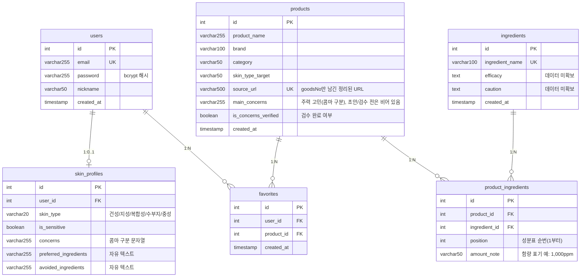

# ERD (현재 구현 기준)

> 기준: `backend/app/models/` (2026-10-15). 설계 재정비 중이라 `TBD` 표시는 추후 확정.

## 테이블 설명

| 테이블 | 설명 |
|---|---|
| users | 회원. 이메일 중복 불가, 비밀번호는 bcrypt 해시로 저장 |
| skin_profiles | 유저당 1개의 피부 프로필. `concerns`는 허용 목록 6개 값을 콤마로 이어 저장 |
| products | 제품 기본 정보 (CSV 수기 수집) |
| ingredients | 성분 마스터. 효능/주의사항은 비어 있음 |
| product_ingredients | 제품-성분 N:M 연결 테이블 |
| favorites | 유저의 즐겨찾기 |

## 알려진 한계 / 변경 예정 (TBD)

| 항목 | 내용 |
|---|---|
| `products.main_concerns` | 컬럼 추가 완료(마이그레이션 0002). 값은 아직 비어 있음 → LLM 초안 + 사람 검수로 채울 예정 |
| 피부 타입 적합도 | `skin_type_target`은 대부분 "모든 피부"라 변별력 없음. 자체 판단 컬럼 분리 여부 미정 |
| 성분 순서 | `position` 저장 완료. 1% 이하 구간은 순서가 함량을 뜻하지 않으므로 스코어링에서는 앞쪽 N개만 쓸지 미정 |
| UNIQUE 제약 | `favorites(user_id, product_id)`, `skin_profiles(user_id)`, `product_ingredients(product_id, ingredient_id)` 등 추가 완료 (0002) |
| 규제 성분 | 금지/한도 성분 테이블 없음 (식약처 공공데이터 연동 예정) |
| 마이그레이션 | Alembic 도입 (`backend/migrations`). 0001 기준선, 0002 컬럼·제약 추가 |
| `concerns` 저장 방식 | 콤마 문자열 → 별도 테이블 또는 JSON 컬럼 전환 검토 |
