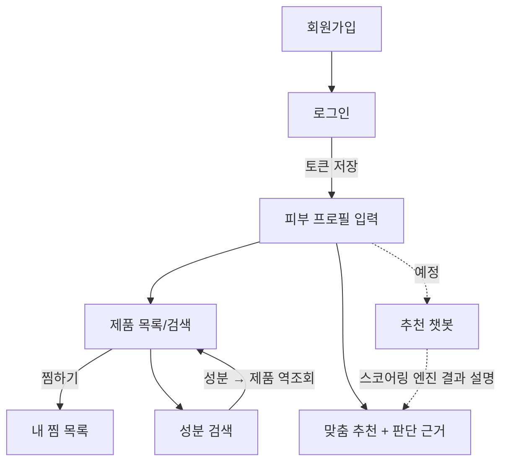
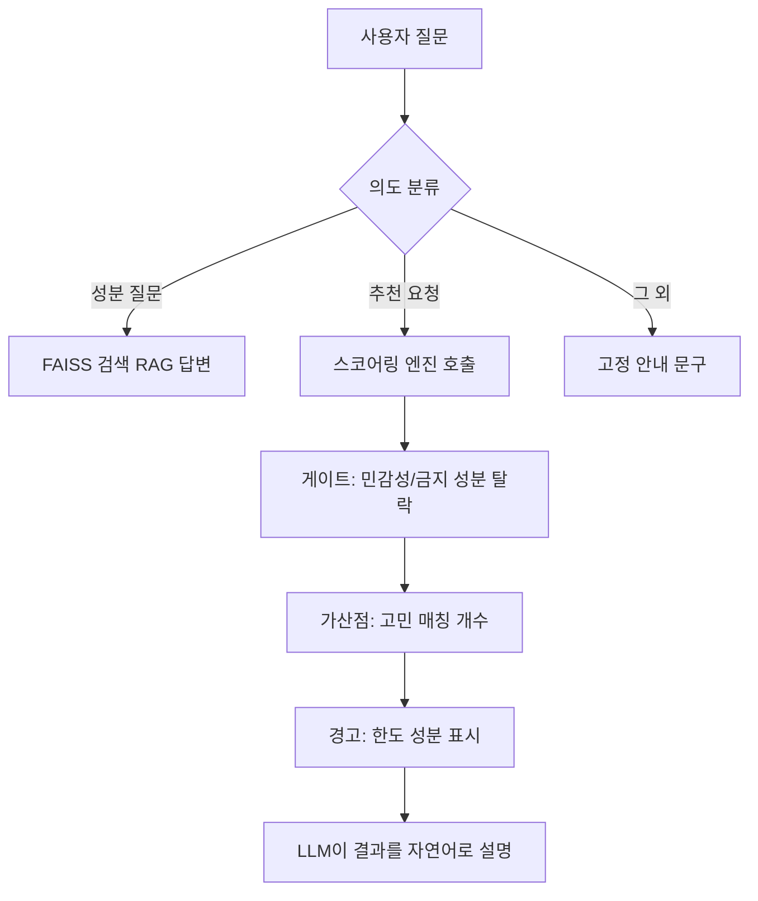

# 사용자 흐름 (현재 구현 기준)

> 기준: `frontend/src/` (2026-10-24)

## 화면(라우트) 목록

| 경로 | 화면 | 로그인 필요 | 비고 |
|---|---|---|---|
| `/` | - | - | 로그인 상태면 `/recommend`, 아니면 `/login`으로 이동 |
| `/login` | 로그인 | - | 성공 시 토큰 저장 후 원래 가려던 페이지(기본 `/recommend`)로 이동 |
| `/signup` | 회원가입 | - | 성공 후 로그인 화면으로 이동 |
| `/recommend` | 맞춤 추천 | ✔ | 고민 매칭 개수 순 추천, 걸러낸 제품과 사유, 한도 성분 경고. 프로필 없으면 등록 안내 |
| `/profile` | 피부 프로필 | ✔ | 등록/수정 |
| `/products` | 제품 목록·검색 | 조회는 불필요 / 찜하기는 필요 | 카테고리 필터, 제품명 검색 |
| `/favorites` | 내 찜 목록 | ✔ | 찜 취소 |
| `/ingredients` | 성분 검색 | - | 성분 클릭 시 해당 성분이 든 제품 펼침 |

## 핵심 흐름

## 추천 챗봇 흐름 (설계, 미구현)

## 미구현 / TBD

- 로그인 필요 페이지(✔)는 `components/RequireAuth.jsx` 한 곳에서 확인, 상단 `NavBar`에 로그아웃 버튼
- 토큰 만료(401) 시 추천 화면에서 토큰 삭제 후 로그인으로 이동 (다른 화면은 미적용)
- 챗봇 라우팅·멀티턴 상세 설계 (별도 문서화 예정)
